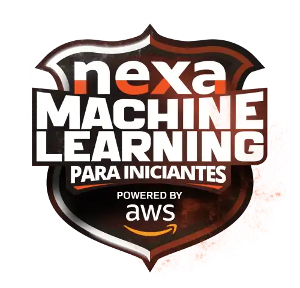
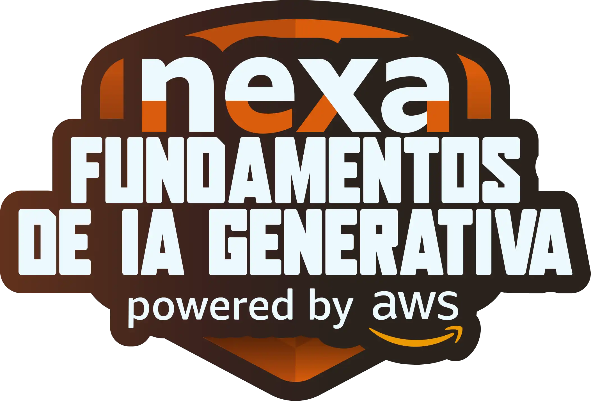
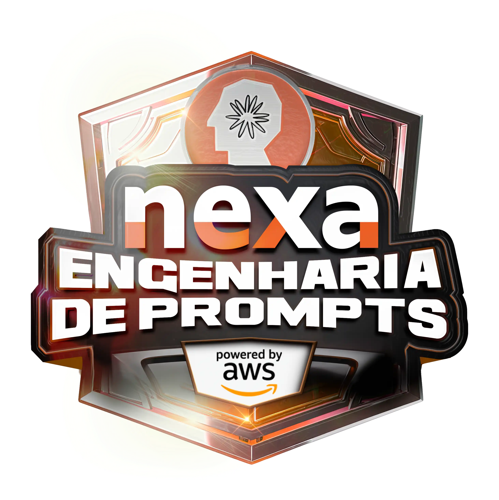

# Artificial Intelligence (AI)  

### Repository: [boot](../../)
### Platform: <a href="../">dio   </a>
### Software/Subject: <a href="./">ai   </a>

---

This folder refers to all the courses I took on the Digital Innovation One (DIO) platform regarding Artificial Intelligence content.

### Bootcamps:
- <a href="./boot_023/">boot_023 (Bootcamp Nexa - Machine Learning para Iniciantes na AWS)   </a>
- <a href="./boot_024/">boot_024 (Formação Fundamentos de Inteligência Artificial)   </a>
- <a href="./boot_028/">boot_028 (Bootcamp Nexa - Fundamentos de IA Generativa e Claude 3)   </a>
- <a href="./boot_029/">boot_029 (Bootcamp Nexa - Engenharia de Prompts na AWS com Claude)   </a>
- <a href="./boot_037/">boot_037 (Bootcamp Nexa - Fundamentos de IA Generativa com Bedrock)   </a>